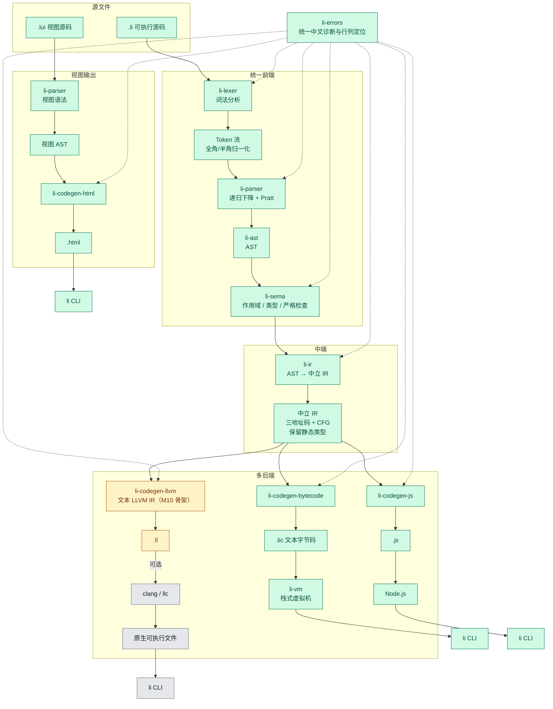

# li 编译器架构图

> 配套文档：[`方案.md`](./方案.md)、[`AGENTS.md`](./AGENTS.md)  
> 所有用户可见诊断均经过 `li-errors`，统一使用 `第 N 行第 M 列：...` 中文格式。

## 1. 编译器流水线总览

## 2. 关键边界与不变量

| 边界 | 规则 |
| --- | --- |
| 前端 → IR | 前端只产出 AST 与统一诊断，不感知任何目标平台 |
| IR → 后端 | 可执行后端（字节码、JS、LLVM）只消费中立 IR，不得反向依赖 AST |
| 视图 → HTML | HTML 后端是视图专用例外，直接消费视图 AST，不参与可执行代码流水线 |
| 诊断 | 所有用户可见错误必须为中文，并携带 `第 N 行第 M 列` 定位 |
| 不安全 | `不安全` 块与 `原生指针<T>` 只能由支持底层内存的后端接受；JS 后端必须拒绝 |

## 3. 状态图例

- 绿色：已完成并接入 CLI 的能力；
- 黄色：骨架已交付、运行时对象尚未实现的能力；
- 灰色：尚未实现、仅在设计层预留的能力。

当前绿色覆盖词法、语法、语义、中立 IR、字节码、VM、JavaScript、HTML 与标准库；
黄色覆盖 LLVM 文本后端；灰色覆盖并发关键字与原生运行时完整对象模型。
